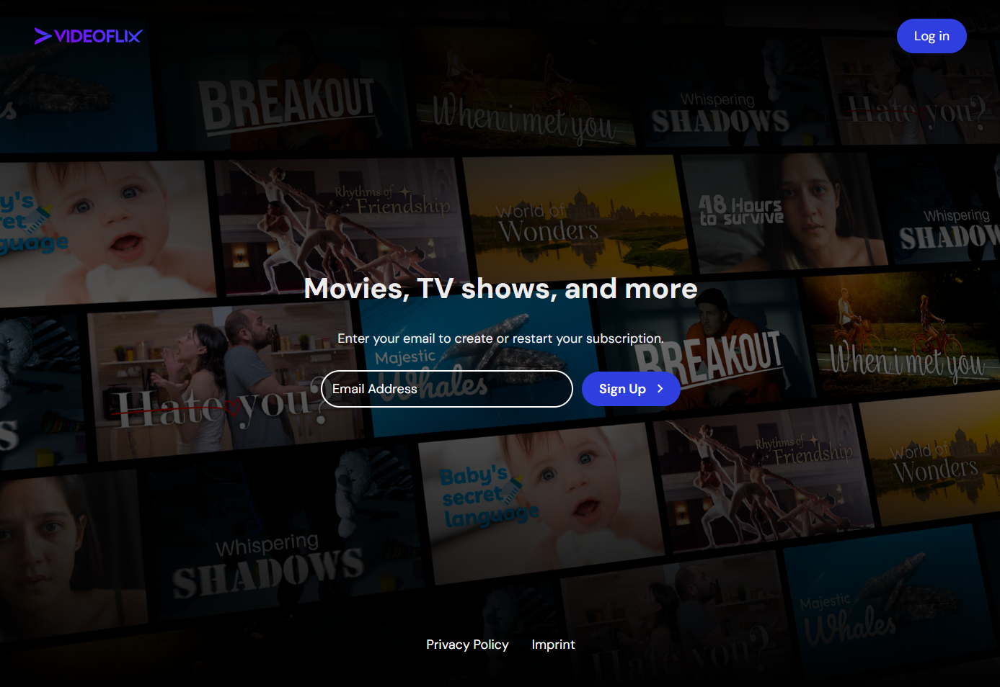
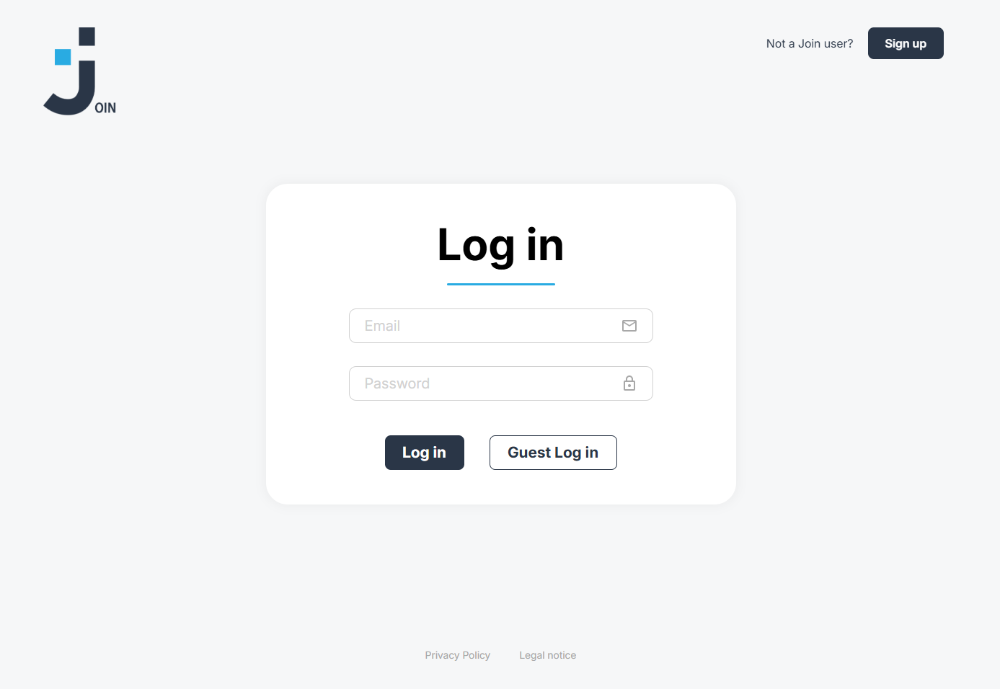
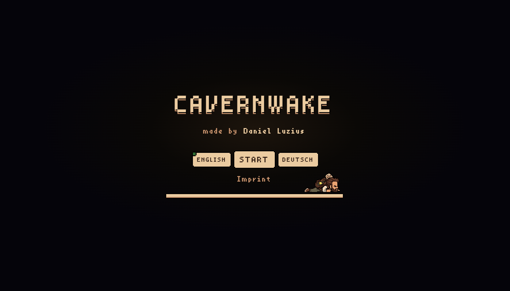

<div align="center">

# Daniel Luzius

Personal portfolio for a fullstack developer based in Seligenstadt. The live site is in German and English.

[](https://danielluzius.dev/)
[](https://angular.dev/)
[](https://www.typescriptlang.org/)

<br>

<a href="https://danielluzius.dev/">
  
  
  
</a>

</div>

## The site

[danielluzius.dev](https://danielluzius.dev/) is a single page with a project overview, legal notice, and privacy policy. The header switches between German and English. The choice is kept in the browser.

| Section | What it shows |
| --- | --- |
| Hero | Name, role, and a direct mail link |
| About | Short profile and portrait |
| Skills | Frontend and backend technologies |
| Projects | Featured work, each with a preview and a detail dialog |
| References | Colleague quotes |
| Contact | Form that sends mail through EmailJS |

Featured projects on the home page are Videoflix, Join, and Cavernwake. Coderr, Pokédex, and Goblin Slayer are on [All projects](https://danielluzius.dev/all-projects).

| Route | Page |
| --- | --- |
| `/` | Home |
| `/all-projects` | Every project |
| `/legal-notice` | Legal notice |
| `/privacy-policy` | Privacy policy |

Link previews, including WhatsApp, use the portrait in `public/assets/img/daniel_img.jpg`. The Open Graph tags live in `src/index.html`.

## Projects

| Project | About | Live | Code |
| --- | --- | --- | --- |
| Videoflix | Streaming platform with adaptive video | [videoflix.danielluzius.dev](https://videoflix.danielluzius.dev) | [Frontend](https://github.com/Danielluzius/videoflix-frontend) · [Backend](https://github.com/Danielluzius/videoflix-backend) |
| Join | Task manager | [join.danielluzius.dev](https://join.danielluzius.dev) | [Repository](https://github.com/Danielluzius/join-fullstack) |
| Cavernwake | CSS-only pixel adventure | [cavernwake.danielluzius.dev](https://cavernwake.danielluzius.dev) | [Repository](https://github.com/Danielluzius/cavernwake) |
| Coderr | Freelance marketplace | [coderr.danielluzius.dev](https://coderr.danielluzius.dev) | [Frontend](https://github.com/Danielluzius/coderr-frontend) · [Backend](https://github.com/Danielluzius/coderr-backend) |
| Pokédex | API-based Pokédex | [pokedex.danielluzius.dev](https://pokedex.danielluzius.dev) | [Repository](https://github.com/Danielluzius/pokedex) |
| Goblin Slayer | Jump-and-run game | [goblinslayer.danielluzius.dev](https://goblinslayer.danielluzius.dev) | [Repository](https://github.com/Danielluzius/goblin-slayer-game) |

Project copy, previews, videos, and links are maintained in `src/app/shared/services/projects.service.ts`.

## Stack

Angular 20 · TypeScript · SCSS · RxJS · Transloco

Both languages live in `public/assets/i18n/en.json` and `public/assets/i18n/de.json`. The contact form uses EmailJS. The service id, template id, and public key sit in `src/app/shared/services/email.service.ts`.

## Development

Node.js 20.19 or newer.

```bash
npm install
npm start
```

Open http://localhost:4200/. The app reloads when source files change.

## Production build

```bash
npm run build
```

Upload the contents of `dist/portfolio/browser` to the web host. The host should serve `index.html` for unknown paths, so `/all-projects`, `/legal-notice`, and `/privacy-policy` still open after a refresh.

## Contact

[kontakt@danielluzius.dev](mailto:kontakt@danielluzius.dev) · [GitHub](https://github.com/Danielluzius) · [LinkedIn](https://www.linkedin.com/in/daniel-luzius-03684636b/)
